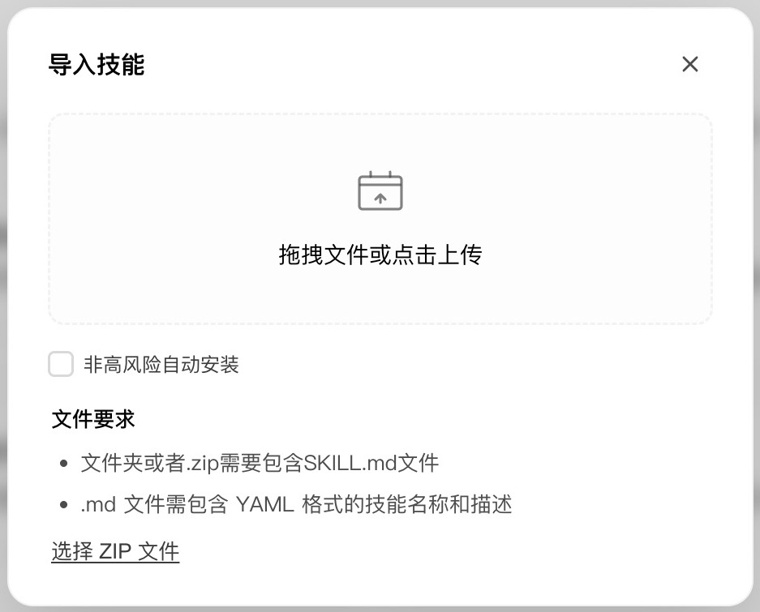

# WorkBuddy：安装、启用与第一次只读验收

配合课件第32、37–39页。课堂默认使用 WorkBuddy；已经配置好 PaperDaily MCP 的参会者可以直接进入只读验收。

## 课前准备

1. 安装并登录 WorkBuddy，登录 PaperDaily。
2. 确认电脑能运行 Python 3.10 或以上；两个 skills 的查询脚本需要 Python。图形界面导入不要求参会者先安装 git 或 uv。
3. 下载下面两个完整 ZIP 包。它们使用此前真实研究演示的版本，不代表最新版本。

| 包 | 实测版本 | 用途 |
|---|---|---|
| [paperdaily.zip](handouts/paperdaily.zip) | 0.4.2 | 论文发现、DOI 解析、详情与上下文 |
| [paperdaily-deep-research.zip](handouts/paperdaily-deep-research.zip) | 0.8.1 | 原文获取、真实阅读记录、跨篇证据综合 |

两个包均来自官方仓库 [paperdaily-skills](https://github.com/alonegg/paperdaily-skills) 的已核验提交 `036ba21d15662a1f487fc1726a0fad22f1e734fe`；打包时验证了发布清单的61份文件哈希，并逐项核对 ZIP 中的14/29份 skill 文件，另附 LICENSE。SHA256 见 [manifest.json](handouts/manifest.json)。没有打包任何本机凭证。

## 1. 分别导入两个 skills

WorkBuddy 左侧「专家·技能·连接器」→ 顶部「技能」→「添加技能」→「上传技能」→「选择 ZIP 文件」。分别选择上述两个包，按客户端提示检查并确认导入。



每个 ZIP 根目录直接包含 `SKILL.md`，并保留 `lib/`、脚本和配套资源。只上传一个 `SKILL.md` 会漏掉执行代码；下载整个 GitHub 仓库的 ZIP 也不等于这两个独立技能包。

若已安装同名技能，先检查现有版本并保存自定义修改，避免在正在研究的任务中途替换文件。

## 2. 配置本机 PaperDaily key

在 PaperDaily「账号设置 → API Keys」创建本次研究使用的 key，先选 `read:paper`、`read:digest`。由本人在本机填写，不贴进聊天或群里，不让 Agent 回显。

skills 从用户主目录下 `.paperdaily-cli/env` 读取配置：

- macOS / Linux：`~/.paperdaily-cli/env`。
- Windows：用户主目录下 `.paperdaily-cli\env`，通常为 `%USERPROFILE%\.paperdaily-cli\env`。
- 文件名为 `env`，不要保存成 `env.txt`；已有文件先检查，再按需修改。

配置内容如下，需在本机将占位符换成自己的 key：

```sh
export PD_BASE="https://www.paperdaily.org/api/v1"
export PD_KEY="<在本机填写你的 PaperDaily key>"
```

macOS / Linux 将目录权限设为700、文件设为600；Windows 使用仅本人可访问的文件权限。没有把握时请助教协助。MCP 的 `PAPERDAILY_API_KEY` 与 skills 的 `PD_KEY` 是不同配置入口；只在 MCP 中填 key，不能据此认定 skills 也已配置好。

## 3. 启用后新建任务，做真实验收

回到「技能 → 已安装」，确认 `paperdaily` 和 `paperdaily-deep-research` 两项都已开启，然后新建 WorkBuddy 任务。旧任务可能仍保留旧版技能说明。

第一条委托：

> 请确认你实际加载的 paperdaily 与 paperdaily-deep-research skill 名称和版本。若使用 MCP，请列出当前可用的 PaperDaily 工具。只检查本次相关配置，不显示任何 key、Cookie、账号标识或授权 URL；缺少依赖或凭证时明确报告，不执行写操作或收费 Ask。

第二条委托：

> 请实际使用 paperdaily skill 或已连接的 PaperDaily MCP，按 DOI 10.1093/qje/qjae044 查找论文。报告 paper_id、标题、版本和本次实际取得的材料深度，并说明调用路径与工具或脚本名称。缺失内容标未知；不要凭记忆补齐，不扩展检索、不上传、不改兴趣、不调用收费 Ask。

**完成标志：**核对实际调用记录与响应，并报告paper_id、版本、材料层级和调用路径；缺失字段标未知。仅返回一个ID不足以证明调用已执行。只说“安装好了”或回答论文的一般信息，均不足以通过验收。只有 skills 可用的参会者不必列出 MCP 工具。

可进一步请 Agent 使用已加载的 `paperdaily/scenarios/pd.py doctor --json` 做只读诊断，并仅报告配置、依赖和调用是否可用，不回显凭证。诊断成功仍不等于完成全文深读。

## 4. 检查浏览器连接，按本人授权获取原文

Agent 的材料不只来自 API 和本地 PDF。安装的 deep-research skill 也规定了 OA、机构授权直连、本人 Chrome 会话和网页检索补充原文的流程。WorkBuddy 的浏览器操作可与它组合使用。

本机5.9.3在「设置 → 智能体 → 浏览器操控 Beta」提供控制浏览器与扩展入口；本轮 Chrome / Edge 显示“无法确认安装状态”。这张实拍已放入课件第39页，不能将入口存在当作连接成功。请先检查本人的实际工具和目标会话，确认能读取已授权的文章页面，再进行原文获取与版本核验。

完整步骤、实际状态、skill原文依据、可直接复制的委托和验收表见[授权网页与原文获取](授权网页与原文获取.md)。本场不要求统一启用 Chrome remote debugging，也不要求同时安装多个浏览器技能；新增扩展或系统访问权限由本人按具体范围确认。

## 已有 MCP 的可选路径

已有 WorkBuddy PaperDaily MCP 连接可直接做上述验收。新配置按 PaperDaily 帮助中心的「连接 MCP」以及当前客户端连接器说明操作。

助教在本机安装官方 `paperdaily-mcp` 后，客户端 stdio 配置的结构为：

```json
{
  "mcpServers": {
    "paperdaily": {
      "command": "paperdaily-mcp",
      "args": [],
      "env": {"PAPERDAILY_API_KEY": "<仅在本机填写>"}
    }
  }
}
```

`paperdaily-mcp` 必须在 WorkBuddy 进程可找到的路径中；必要时使用本机可执行文件的完整路径。MCP 包可通过 `uv tool install paperdaily-mcp` 安装，但这不是本场 skills 导入路径的前置条件。配置字段与入口以运行中的客户端和官方帮助为准。

## 实测依据与范围

- 此前在 WorkBuddy 的本地技能目录 `~/.workbuddy/skills/` 完成0.4.2 / 0.8.1安装文件核验、两项启用及新任务执行，见 [skill-update-receipt.json](../materials/agent-demo/skill-update-receipt.json)。
- 2026-11-01重新打开 WorkBuddy，实际核实了「添加技能 → 上传技能 → 选择 ZIP 文件」和格式要求，并补拍上述截图。本轮没有再次导入包、替换已安装文件或更改凭证。
- 课堂包验证覆盖内容完整性；还未在全新账号及 Windows WorkBuddy 上完成从导入到研究任务的全链路验收。
- [原文核验与日报深析](../materials/agent-demo/)保留此前真实研究演示及审阅后的材料；安装成功后仍按课件的证据标准验收研究产出。


## 开始研究：先明确本轮范围

安装与第一次调用完成后，参照[Skills研究入门与IS思想](Skills研究入门与IS思想.md)选择问题、种子论文或已有日报/记录为起点。先形成候选池、概念/争点框架和选读理由，再进入授权原文与证据综合；不要求每个任务一次完成整套综述。对应课件第40–41页。

## 后续研究所需权限与交接

首次只读调用使用`read:paper`、`read:digest`，不等于已经取得全部私人研究记忆与任务写权限。按研究需要逐项核对：

| 后续操作 | 权限或交接要求 |
|---|---|
| 读取收藏与阅读行为记录 | `read:contrib` |
| 读取主站深读成果与Agent任务收件箱 | `read:reading` |
| 领取、完结相应任务或上传分析成果 | `write:reading`，并经本人明确同意 |
| 读取自己的日报 | `read:digest`；日报资格与内容是否已生成另行核对 |
| API尚未开放的对象或RiD中的笔记 | 按产品实际入口导出或摘录，由本人授权交接；不假设自动同步 |

本说明没有替参与者签发或扩大真实key权限。创建新key后须在本机安全配置中填写，MCP连接器与skill的env为不同入口。先确认scope与材料可见范围，再委托实际任务。官方口径见[API权限说明](https://www.paperdaily.org/help/reference/api-scopes)。

主站、Ask与个人API使用主站账号权益；RiD独立服务的登录、资料连接、原文导入和处理费用按其自身流程确认。使用本地Agent深读时，原始PDF留在本地；这不代表将PDF导入RiD时也没有资料传输。
