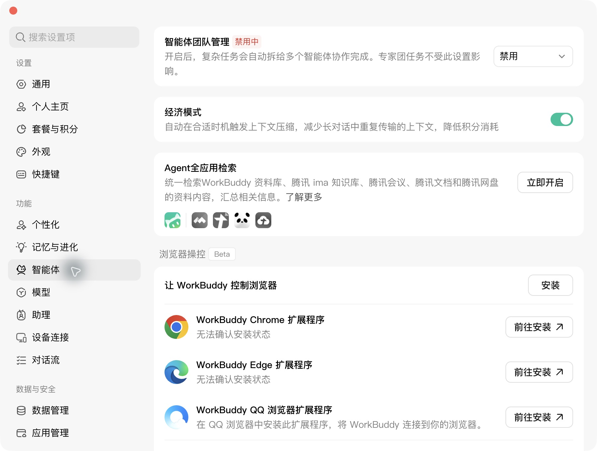

# Agent 从授权网页获取原文，再进入深读

配合课件第34–39、48–49页。核对日期：2026-11-01。这里补全的是从论文线索到可核验原文的路径：**PaperDaily 提供定位、前置分析与研究记忆；研究者的 Agent 还可以使用浏览器，到本人有权访问的来源取得材料，再组织阅读和讨论。**

## 这条路径解决什么问题

日报或综述给出一篇值得追的论文，但平台抽取不足以判断样本、识别策略或机制。研究者可以委托 Agent：

1. 用 PaperDaily 核对论文身份和版本，带上已有问题与判断。
2. 寻找 OA、作者主页、机构库等合法全文；也可进入本人已有访问权的出版商页面。
3. 在实际获得授权的浏览器会话里打开文章，读取完整 HTML 或取得 PDF；不能把摘要页、登录页、试读片段当作全文。
4. 核对版本与完整性，按研究争点定向阅读，或另行通读。记录来源、版本、实际读到的位置、证据和未知项。
5. 将证据交回当前问题，与已有文献比较；研究者核对后更新判断和下一项任务。也可以按 RiD 的导入与处理规则，将材料带入 RiD 细读。

例如：日报出现一篇“生成式 AI 改变协作网络”的新研究。Agent 可以先与已保存的“即时绩效提升”文献比较，发现需要核对协作对象与观察期；再到本人授权网页取得原文，检查实际测量和识别设计。下一次不必重建这份背景，而是从已保存并能取回的证据、未知项和任务继续。是否改变原判断，由材料决定。

## MCP、浏览器与 skill 分别做什么

| 能力 | 在本例中的职责 | 需要单独确认的事 |
|---|---|---|
| PaperDaily MCP / API | 解析 DOI、查论文与上下文、取日报和已开放的研究记录 | 本机配置、key scope、账号权益、返回材料深度 |
| WorkBuddy 浏览器操作 | 打开目标网页、滚动或展开、读取页面、按实际工具能力获取文件 | 当前系统和版本、浏览器连接、目标站点及会话的真实访问权 |
| computer use | 在客户端和系统支持时操作桌面或浏览器界面 | 当前可用工具与系统权限；不能推定各平台都支持 |
| paperdaily-deep-research | 组织获取、阅读、来源台账、证据锚点与综合分析 | skill 已加载、依赖可用、原文真实取得与实际阅读范围 |
| 研究者 / RiD | 研究者作判断，可在 RiD 对照原文、译文与批注 | RiD 自身资料传输、处理费用与授权；跨端交接是否完成 |

PaperDaily 的 API key 不授予出版商访问权。装好 deep-research skill，也不等于浏览器已连接。WorkBuddy 内置浏览器或独立自动化会话，不保证继承日常 Chrome 的机构登录；应检查**真正要执行任务的那个会话**。

## WorkBuddy：本轮实际看到了什么

本机应用元数据为 **5.9.3**。已在实际界面进入「设置 → 智能体」，看到「浏览器操控 Beta」「让 WorkBuddy 控制浏览器」及 Chrome / Edge / QQ 浏览器扩展入口。Chrome、Edge 的画面状态为**无法确认安装状态**；本轮未点击安装或前往安装，未开启调试端口或扩大系统权限。

官方资料提供两类依据：

- [WorkBuddy 更新日志](https://www.codebuddy.cn/docs/workbuddy/Changelog)记录 Browser Use 能力及浏览器扩展支持，也记录过“实验性 computer-use 工具（仅 macOS）”。这不是对所有当前系统配置的保证。
- [官方 Agent Browser 说明](https://www.codebuddy.cn/docs/workbuddy/From-Beginner-to-Expert-Guide/WorkBuddy-Zero-Cost-Skill-Top-10/Agent-Browser)介绍额外的 `agent-browser` skill，可打开网页、交互、截图与读取动态内容。它与本机设置中的浏览器操控扩展、deep-research 的 CDP 脚本是不同入口；本课不要求同时安装。

**当前验收状态：**客户端入口和截图已核实；skill 与课堂 ZIP 的相关说明已核对。尚未完成 WorkBuddy 连接现有 Chrome、读取本人机构会话、获取目标出版商完整论文的端到端实测。此前演示的下载来自 `L0_arxiv`，之后只读了 v2 的第5.2节，不能将它算作机构浏览器获取正式版的成功证据。

## 课前连接检查

1. 在研究者实际使用的浏览器里，打开目标论文的出版商页面，确认本人能看到完整正文或取得全文；仅显示机构名称、题录或摘要不足以证明该篇可访问。
2. 先检查 WorkBuddy 当前实际可用的浏览器工具与连接状态。已有连接就使用；若需要新扩展或系统权限，由本人按客户端提示明确授权，确认范围后再连接。
3. 委托 Agent 仅打开指定文章页面，核对题名、作者、DOI 和版本，并报告它实际看到了哪些内容。不要将普通网页搜索的摘要冒充登录后页面。
4. 再尝试取得一篇全文，核对章节、页数/结构、版本与正文完整性。PDF 格式正常或 HTTP 200 都不足以单独通过验收；完整 HTML 同样可以成为阅读载体。
5. 登录和验证码由本人完成；遇到拒绝、验证阻断或试读，只记录实际状态。若暂时无法连接，可由本人下载合法原文到本地后继续阅读，并注明人工交接。

可直接使用的只读连接预检委托：

> 先检查当前 WorkBuddy 是否实际提供浏览器操作工具，以及是否已连接到我指定的浏览器会话。只报告相关工具名称、连接是否可用、能否打开我指定的文章页面及实际取得的材料深度。不要只凭 skill 文档声称已经支持；不要列出无关标签页、浏览历史或凭证。缺少连接时说明具体缺项，不自行安装扩展、开启调试端口或更改系统权限。

## 可直接交给 Agent 的研究委托

先由研究者填写目标 DOI、来源链接、保存目录和已授权会话。下列示例只授权一篇材料获取及定向阅读，实际执行前应按本人的访问权限填写。

> 使用 paperdaily 和 paperdaily-deep-research，围绕“生成式 AI 的当期辅助，能否转化为之后独立完成任务的能力”继续研究。
>
> **目标：**核对 DOI `10.1093/qje/qjae044` 的论文身份与目标正式版；本次不扩展文献池。先读取我提供的上一轮问题、矩阵和待核事项；缺少记录就说明。
>
> **授权来源：**仅使用我明确指定的文章链接与已授权浏览器会话：[填写链接与会话]。先确认该会话实际能访问全文，再操作。可使用该文的合法 OA 或作者/机构库版本，但必须标明版本关系，不替换后仍称为正式版。不访问其他账号资料、不复制 Cookie 或凭证。
>
> **获取与记录：**取得完整 PDF 或完整 HTML，保存到 [本地目录]。记录 DOI、题名、作者、来源 URL、访问时间、版本、文件路径与 SHA256、载体和完整性检查结果。资料与截图中不保留授权查询参数、账号标识或凭证。只有试读片段就标 partial；验证阻断记 blocked；明确无权限记 denied。登录或验证码交由我处理，不购买、不绕过拒绝。
>
> **定向阅读：**核查学习、经验曲线、AI 中断期表现及作者局限讨论。逐项回答：测量的是即时辅助、短期表现还是长期保持？识别边界是什么？每条判断附本次版本的真实页码或章节/段落锚点，区分作者发现、作者解释和你的推断。没有读到就标未知，不将局部阅读写成全文深读。
>
> **交付：**材料获取台账、一篇定向阅读笔记、对已有矩阵需要确认或修订的条目、下一项待核任务。原文留在指定本地目录；本次不上传成果、不导入 RiD、不改平台研究记录。先交给我验收，再决定后续保存与回传。

## 安装的 Deep Research skill 原本怎样写

核对版本为 `paperdaily-deep-research 0.8.1`。本机 `~/.workbuddy/skills/paperdaily-deep-research/` 与[课堂 ZIP](handouts/paperdaily-deep-research.zip)中的下列说明一致，文件哈希见[核对回执](../plan/authorized-browser-fulltext-validation.json)：

- `SKILL.md` 第2阶段：默认 OA；机构直连与用户浏览器限于已确认授权；完整 PDF、HTML、带位置的解析全文可用于阅读；下载账本不证明读过。
- `references/fulltext-sources.md` 的 L5：机构授权直连；须确认执行环境确实处于订阅授权范围。
- L6：可选 headless 浏览器，处理需要 JS 渲染的合法下载入口。
- L6b：可选本人 Chrome 会话；脚本用 `PD_FETCH_CDP=1` 和远程调试连接。**这是可选技术路径，不是 WorkBuddy 的必装扩展，也不是本次已启用的配置。**
- L7：网页检索作者主页、机构库等合法副本，回填 `urls_extra` 后续跑；OA 聚合接口未命中不等于没有合法公开版本。

这些脚本开关应按当前 skill 帮助、客户端和 Chrome 实际支持情况配置，仅在确认的范围内按需启用，不写成所有参与者的全局默认。需要新增访问权限时另行明确授权。本次只读核对，没有运行浏览器获取脚本。

## 验收一份产出

| 核对项 | 需要的证据 |
|---|---|
| 这篇是谁、哪个版本 | DOI/其他强标识、题名与作者、来源、版本关系 |
| 取得了什么 | PDF/HTML/解析全文/摘要/平台抽取/试读，完整性及文件台账 |
| 实际读了哪里 | 真实页码/章节/段落锚点，阅读范围与时间；获取完成不等于阅读完成 |
| 能支持什么 | 关键证据、适用边界、作者解释与 Agent 推断的区分 |
| 下一次怎样继续 | 已确认或待修订判断、未知项、下一任务；保存位置与取回状态 |

“本地”说明原文的获取与存放路径，不保证 Agent 模型推理也完全在本机。模型与数据处理去向依本人客户端配置；导入 RiD、将派生成果写回 PaperDaily、公开共享是不同的后续操作，应分别确认具体内容、范围与是否完成。个人可访问一篇论文，也不能由此推定具有批量自动抓取或再分发权；批量研究按来源的实际许可与 TDM 路径执行。
